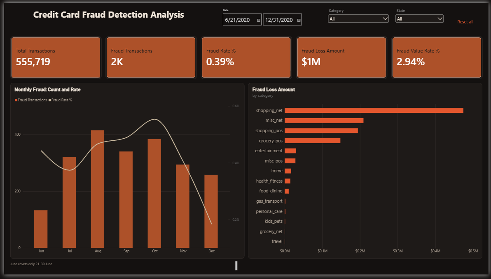
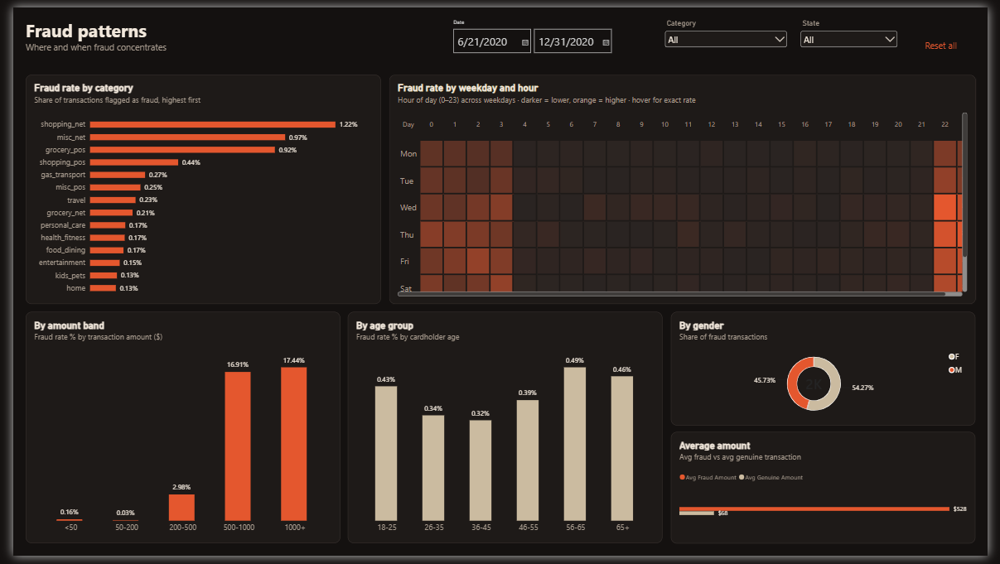
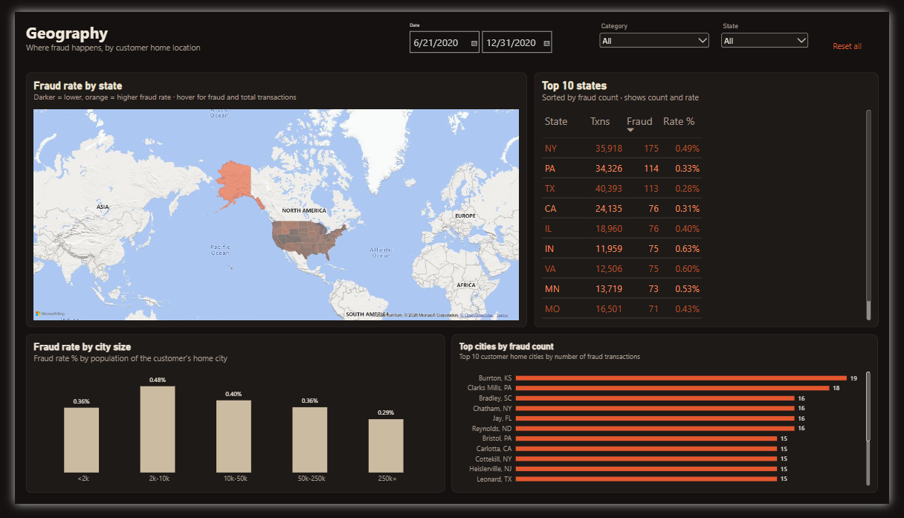
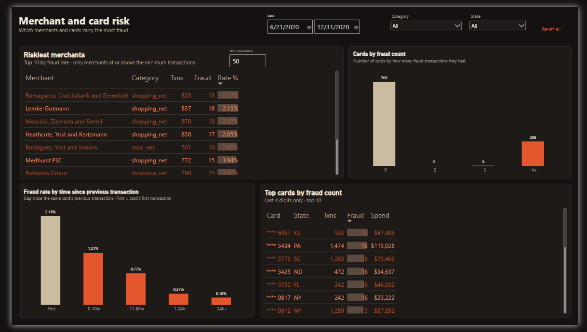
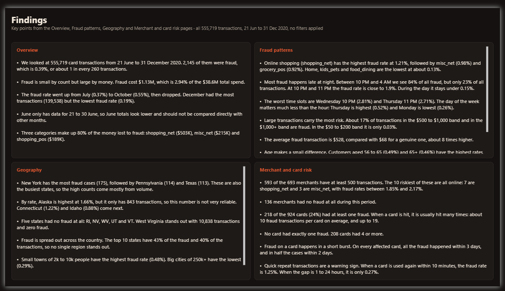
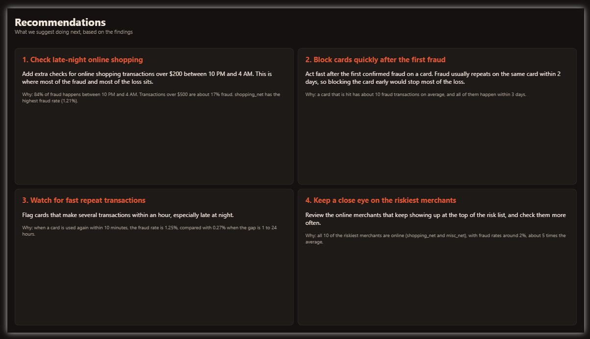

# Credit Card Fraud Detection Analysis

An end-to-end analytics project on **555,719 credit card transactions** (21 June – 31 December 2020). The goal is to find out **when, where and how fraud happens** and to suggest practical ways to reduce it.

The raw data is cleaned in **Python**, loaded into a **MySQL** star schema, analysed with **SQL**, and presented in a six-page **Power BI** report.

| | |
|---|---|
| **Transactions** | 555,719 |
| **Fraud transactions** | 2,145 (0.39%, about 1 in 260) |
| **Money lost to fraud** | $1.13M (2.94% of $38.6M total spend) |
| **Cards / merchants** | 924 cards · 693 merchants · 14 categories |

---

## Tools

| Stage | Tool | What it does |
|---|---|---|
| Cleaning & feature engineering | Python (pandas, NumPy) in Jupyter | Checks data quality, fixes types, adds new columns, builds the star schema |
| Storage | MySQL | `fraud_analysis` database with one fact table and two dimension tables |
| Analysis | SQL | KPIs, breakdowns, window functions, CTEs and views |
| Reporting | Power BI (PBIP project format) | Six-page interactive report with DAX measures |

```
fraudTest.csv ──► Jupyter notebook ──► MySQL (star schema) ──► SQL analysis
                   (clean + features)            │
                                                 └──────────► Power BI report
```

---

## Repository structure

```
credit-card-fraud-analysis/
├── notebooks/
│   └── data_cleaning_and_transformation.ipynb   # cleaning, feature engineering, MySQL load
├── sql/
│   ├── 01_schema.sql                            # database + tables + row-count checks
│   ├── 02_analysis_queries.sql                  # analysis queries
│   └── 03_views.sql                             # reusable views
├── powerbi/
│   ├── Credit Card Fraud Detection.pbip         # open this in Power BI Desktop
│   ├── Credit Card Fraud Detection.Report/      # report pages and visuals
│   └── Credit Card Fraud Detection.SemanticModel/  # tables, relationships, DAX measures
├── images/                                      # report page screenshots
└── data/                                        # put fraudTest.csv here (not tracked)
```

---

## Data

**Source:** [Credit Card Transactions Fraud Detection Dataset (Kaggle)](https://www.kaggle.com/datasets/kartik2112/fraud-detection). This project uses `fraudTest.csv`.

The dataset is **simulated**. It was generated with a transaction simulator, so it contains no real customers. The raw file is about 150 MB, which is over GitHub's file size limit, so it is not included here. Download it from Kaggle and place it in `data/`.

---

## 1. Data cleaning and transformation (Python)

`notebooks/data_cleaning_and_transformation.ipynb`

**Quality checks**
- No duplicate rows, no missing values, no zero or negative amounts.
- 2,145 of 555,719 transactions are fraud. The data is highly imbalanced.

**Cleaning**
- Dropped columns that are not needed or are personal: row index, first name, last name and street.
- Converted transaction time and date of birth to datetime. Stored card numbers and zip codes as text.
- Removed the `fraud_` prefix from merchant names.
- Renamed columns to clear names, for example `amt` → `amount` and `is_fraud` → `fraud_flag`.

**New columns (feature engineering)**

| Column | How it's built |
|---|---|
| `hour`, `day_of_week`, `month`, `is_weekend` | From transaction time |
| `age`, `age_group` | Age at the time of the transaction, grouped 18-25 … 65+ |
| `time_of_day` | Night / Morning / Afternoon / Evening / Late Night |
| `amount_band` | <50, 50-200, 200-500, 500-1000, 1000+ |
| `distance_km` | Distance between the customer and the merchant (haversine formula) |

After this, the redundant columns (`zip`, `dob`, `unix_time`, `job`) are dropped. The data is split into a **star schema** and loaded into MySQL. A cleaned Parquet copy is also saved.

---

## 2. Data model (MySQL star schema)

```
            dim_customer                     dim_merchant
   (card_number, gender, city, state,   (merchant_id, merchant_name,
    city_pop, lat/long)  924 rows          category)  693 rows
                 │                                │
                 └────────► fact_transactions ◄───┘
                     (transaction_id, card_number, merchant_id,
                      transaction_time, amount, fraud_flag,
                      hour, day_of_week, age_group, amount_band,
                      distance_km, …)  555,719 rows
```

`sql/01_schema.sql` creates the database, the tables and the foreign keys. It also checks that the row counts match after loading.

---

## 3. SQL analysis

`sql/02_analysis_queries.sql` adds indexes and answers the main business questions:

- Overall KPIs: total transactions, fraud count, fraud rate, fraud loss and fraud value rate
- Average amount for fraud vs genuine transactions
- Fraud by category, hour, state and amount band
- **Risk index** by category, using a CTE (category fraud rate ÷ overall fraud rate)
- **Time since a card's previous transaction**, using `LAG()` over each card
- **Daily trend** with a running total of fraud loss and a rolling 7-day fraud rate (window functions)
- **Riskiest merchants** (at least 500 transactions), ranked with `RANK()`
- **Repeat-fraud cards**: how many cards had 1, 2, 3 … fraud transactions

`sql/03_views.sql` creates reusable views: `vw_daily_fraud`, `vw_merchant_risk` and `vw_card_risk`.

---

## 4. Power BI report

Open `powerbi/Credit Card Fraud Detection.pbip` in Power BI Desktop. The report connects to the local MySQL `fraud_analysis` database. Every dashboard page has Date, Category and State slicers and a **Reset all** button.

| Page | What it shows |
|---|---|
| **Overview** | KPI cards, monthly fraud count and rate, fraud loss by category |
| **Fraud patterns** | Fraud rate by category, a weekday × hour heatmap, amount band, age band, gender, and average fraud vs genuine amount |
| **Geography** | Filled map of fraud rate by state, top 10 states, fraud rate by city size, top cities |
| **Merchant and card risk** | Riskiest merchants with a *minimum transactions* slider, cards by fraud count, fraud rate by time since the previous transaction, top cards (masked) |
| **Findings** | Key results from every page, written in plain English |
| **Recommendations** | Four suggested actions, each with the numbers behind it |

**Modelling highlights (DAX)**
- Core measures: `Total Transactions`, `Fraud Transactions`, `Fraud Rate %`, `Fraud Loss Amount`, `Fraud Value Rate %`, `Avg Fraud Amount` and `Avg Genuine Amount`.
- A **what-if parameter** (`Min Transactions`) feeds `Merchant Fraud Rate %`. Small merchants are left out so they don't top the list by chance.
- A disconnected band table feeds `Cards in Fraud Band`, which counts cards by how many frauds they had. Because it is a measure, it follows the slicers.
- Calculated columns:
  - `Mins Since Prev Txn` uses `OFFSET` per card, the DAX version of SQL `LAG()`. `Gap Band` groups it into time bands.
  - `City, State` keeps towns with the same name in different states apart.
  - `Card (masked)` shows only the last 4 digits.
  - `Age Band` adds an *Under 18* group.
- A dedicated Date table for time filtering.

### Screenshots

**Overview**


**Fraud patterns**


**Geography**


**Merchant and card risk**


**Findings**


**Recommendations**


---

## Key findings

- **Fraud happens late at night.** 84% of fraud happens between 10 PM and 4 AM, but only 23% of transactions do. At 10–11 PM the fraud rate is about 1.9%. During the day it stays under 0.15%.
- **Large amounts carry the most risk.** About 17% of transactions over $500 are fraud. The average fraud is $528, compared with $68 for a genuine transaction.
- **Online shopping is the riskiest category.** shopping_net has a 1.21% fraud rate. Together with misc_net and shopping_pos, it makes up **80% of all fraud loss**.
- **Fraud comes in bursts on the same card.** 218 of 924 cards (24%) were hit. A hit card averages about 10 fraud transactions, all within 3 days. When a card is used again within 10 minutes, the fraud rate is 1.25%. With a 1–24 hour gap, it is 0.27%.
- **The riskiest merchants are all online.** The top 10 merchants (with at least 500 transactions) are all shopping_net or misc_net, with fraud rates around 2%.
- **Geography matters less than time and amount.** NY, PA and TX have the most cases, mainly because they have the most transactions. Five states (RI, NV, WV, UT, VT) had no fraud. Small towns (2k–10k people) have the highest rate.
- **Age and gender make little difference.** Rates range from 0.32% to 0.49% across age groups. Women and men are almost the same (0.38% vs 0.39%).

## Recommendations

1. **Add extra checks for online shopping over $200 between 10 PM and 4 AM.** This is where most of the fraud and the loss is.
2. **Block cards quickly after the first confirmed fraud.** Fraud repeats on the same card within 2 days.
3. **Flag cards that make several transactions within an hour,** especially late at night.
4. **Keep a closer watch on the riskiest online merchants.** Their fraud rate is about 5 times the average.

---

## How to run it

1. **Get the data.** Download `fraudTest.csv` from Kaggle into `data/`.
2. **Create the database.** Run `sql/01_schema.sql` in MySQL. It creates `fraud_analysis` and the three tables.
3. **Clean and load.** Set your MySQL login as environment variables, then run the notebook from the `notebooks/` folder:
   ```bash
   # Windows (PowerShell)
   $env:MYSQL_USER = "root"
   $env:MYSQL_PASSWORD = "your_password"
   ```
   Requirements: `pandas`, `numpy`, `sqlalchemy`, `pymysql`, `pyarrow`.
4. **Analyse.** Run `sql/02_analysis_queries.sql` and `sql/03_views.sql`.
5. **Open the report.** Open `powerbi/Credit Card Fraud Detection.pbip` in Power BI Desktop, enter your MySQL login when asked, and refresh.
   - To see the map, turn on *File → Options → Security → Use Map and Filled Map visuals*.

---

## Notes and limitations

- **Simulated data.** The patterns are useful for practice and for showing the method. They are not real-world fraud statistics.
- **June is partial.** It only covers 21–30 June, so monthly totals for June look low.
- **Under 18s.** The notebook's age bins start at 18, so customers aged 15–17 (6,292 transactions) have no age group in the database. The Power BI model groups them as *Under 18*. None of their transactions were fraud.
- **Fixed numbers on the text pages.** The numbers on the Findings and Recommendations pages are for the full period with no filters. They don't change with the slicers.

---

**Author:** Srilekha
